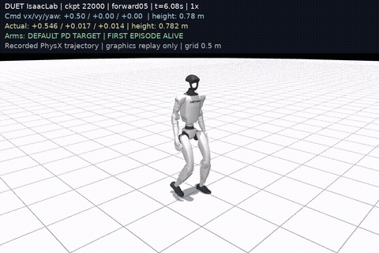

# G1 23DoF Locomotion & Arm-Disturbance Control

An Isaac Lab / PhysX implementation of flat-ground locomotion and decoupled arm-disturbance training for the Unitree G1 23DoF robot.

[中文说明](README.zh-CN.md) · [Installation](docs/INSTALL.md) · [Architecture](docs/ARCHITECTURE.md) · [Training recipe](docs/TRAINING_RECIPE.md) · [Evaluation](docs/RESULTS.md)



The preview shows recorded **PhysX trajectories**, rendered offline without MuJoCo simulation steps. It uses checkpoint **22000**. The evaluated model and all three full videos are available in the [checkpoint 22000 release](https://github.com/yezheng04/unitree-g1-23dof-decoupled-control/releases/tag/v0.1.0-22000); see [download and extraction instructions](docs/ARTIFACTS.md).

## What this project demonstrates

- Adapting locomotion and arm-disturbance training to Isaac Lab's manager-based environments.
- Explicit joint-order mapping for a 23DoF embodiment, including robot limits, PD gains, contact sensors and virtual foot reference points.
- Decoupled control: a 13-action policy controls legs and waist yaw; an independent trajectory generator drives the 10 arm joints.
- Staged velocity, squat-height, arm-motion and push curricula; symmetry augmentation and loss; resumable curriculum and entropy schedules.
- A reproducible evaluation pipeline with fixed commands, first-fall masking, explicit failure counts and verified trajectory replay.

This is a **learning and engineering portfolio** focused on simulation adaptation, training and evaluation for the G1 23DoF robot. Implementation details and physical differences are documented in [Architecture](docs/ARCHITECTURE.md).

## Included task

| Task ID | Policy action | Role |
|---|---:|---|
| `Unitree-G1-23dof-Duet-Velocity` | 13 | Legs + waist locomotion under 10-joint arm disturbances and height commands |

Observations: **71 actor / 96 critic**, single-frame, no HIM encoder. Actor and critic use MLPs `[512, 256, 128]` with ELU and observation normalization.

## Reproduce

Training code is included in this repository: [training entry point](scripts/rsl_rl/train_duet.py), [task and PPO implementation](source/unitree_rl_lab/unitree_rl_lab/tasks/locomotion/robots/g1/duet_velocity/), and [robot and simulator support](source/unitree_rl_lab/unitree_rl_lab/tasks/locomotion/robots/g1/common/).

Use the tested **Python 3.11, Isaac Lab 2.3.2, Isaac Sim 5.1, RSL-RL 3.1.2** environment. Follow [installation](docs/INSTALL.md) before running:

```bash
python scripts/setup/fetch_robot_assets.py
python -m pip install -e .
# Two PPO updates to check your installation; not a trained policy.
python scripts/rsl_rl/train_duet.py --headless --num_envs 64 --max_iterations 2 --offline --run_name smoke
# Full training recipe: 4096 environments, seed 1, 25001 updates, save every 500.
wandb login
python scripts/rsl_rl/train_duet.py --headless
```

The training recipe uses PhysX and RSL-RL 3. See [Training recipe](docs/TRAINING_RECIPE.md) for the configuration and [Architecture](docs/ARCHITECTURE.md) for simulator and implementation differences.

## Measured results

The full run completed **25001 PPO updates** on one RTX 5080. The published quantitative evaluation currently covers **checkpoint 22000**, not the final checkpoint.

| Test | Command | Measured mean |
|---|---:|---:|
| Forward | 0.50 m/s | 0.533 m/s |
| Forward with arm motion | 0.50 m/s | 0.496 m/s |
| Backward | −0.30 m/s | −0.147 m/s |
| Turn in place, left / right | ±0.30 rad/s | +0.209 / −0.201 rad/s |
| Squat height | 0.38 m | 0.382 m |
| Deep squat height | 0.24 m | 0.270 m |

All **304 / 304** evaluated episodes survived the 18-second test. These tests retain friction and payload variation but disable pushes, observation noise, COM shifts and encoder bias. Turning includes approximately 0.92–0.96 m net translation over the 12-second measurement window; lateral commands induce forward drift. Survival alone is not tracking success. See [full protocol and limitations](docs/RESULTS.md).

## Code map

```text
source/unitree_rl_lab/unitree_rl_lab/
  paths.py                       # Portable assets and USD cache
  tasks/locomotion/robots/g1/
    common/                      # Robot, contacts and simulation support; no registered task
    duet_velocity/               # 13+10 control, rewards, curricula and runner
scripts/
  setup/                         # Pinned robot-asset download with SHA256 checks
  rsl_rl/                        # Train and play entry points
  evaluation/                    # Fixed-command evaluation and offline replay
  validation/                    # Source checks and GPU integration validation
deploy/                          # Standalone policy export, MuJoCo and experimental HG DDS control
docs/                            # Recipe, design, reproducibility and limitations
results/                         # Small, sanitized evaluation and completion evidence
licenses/                        # Retained third-party license texts
```

## Deploy

Standalone deployment tools support **MuJoCo sim2sim** and an **experimental G1 EDU 23DoF HG DDS controller**. Export the checkpoint with its observation normalization before deployment. Use Python 3.11; see [environment setup and full deployment guide](docs/DEPLOY.md).

```bash
python -m pip install -r requirements-deploy.txt
python -m deploy.export_policy --checkpoint artifacts/checkpoints/model_22000.pt
# Actual MuJoCo physics; omit --headless to open the viewer.
python -m deploy.sim2sim --headless --vx 0.5 --duration 18
# Hardware controller's default mode: offline inference, no DDS connection.
python -m deploy.sim2real
```

For hardware, install `deploy/requirements-hardware.txt`, confirm the network interface and IMU frame, and begin with a read-only check:

```bash
python -m deploy.sim2real --read-only --interface YOUR_ROBOT_NIC --imu-frame pelvis --duration 10
# After the setup and operator checks in docs/DEPLOY.md:
python -m deploy.sim2real --execute --interface YOUR_ROBOT_NIC --imu-frame pelvis
```

Hold L1 and press Start to move to the default pose; keep L1 held and press A to start the policy. B/Select or releasing L1 requests a latched damping stop. Motion-service takeover requires an explicit `--release-mode`.

## Acknowledgments

Thanks to [DUET](https://github.com/bae-air-lab/DUET) and [HOMIE](https://github.com/InternRobotics/OpenHomie) for their open-source work.
