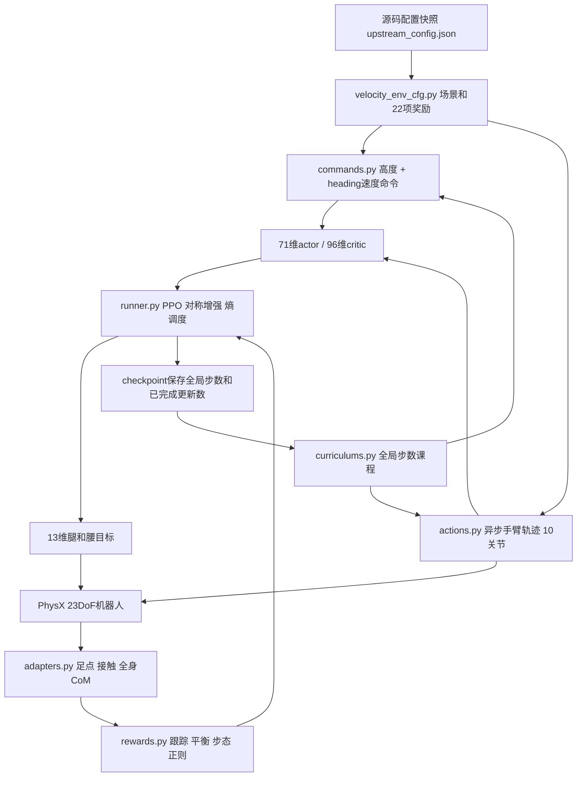

# Architecture and migration decisions

## 6. 代码知识图谱

| 文件 | 职责 |
|---|---|
| velocity_env_cfg.py | 任务场景、观测、动作、payload、奖励及课程装配 |
| upstream_config.json | 上游factory实际生效配置快照，奖励/课程装配的数据源 |
| actions.py | 0维策略动作的上肢term；保留梯形目标轨迹和外部目标接口 |
| commands.py | 高度命令与课程；补齐IsaacLab reset后立即更新高度观测 |
| rewards.py | 上游奖励公式的IsaacLab适配 |
| adapters.py | 精确关节索引、虚拟足点、过滤接触、质量加权CoM、推扰重锁定 |
| curriculums.py | 速度渐变、命令混合、推扰、手臂课程统计 |
| symmetry.py | 左右交换、roll/yaw符号、相位/接触/手臂速度镜像 |
| env.py | 二阶动作历史与诊断日志 |
| runner.py / rsl_rl_ppo_cfg.py | PPO配置、熵调度、对称校验、课程恢复与模型合同 |
| scripts/rsl_rl/train_duet.py | 正式训练入口；每run保存配置、任务源码和版本 |
| scripts/validation/check_duet_port.py | 映射、课程、高度初始化、公式、恢复与推理检查 |

## 7. 与上游相同与不同

保持：13/10控制划分、71/96维观测语义与顺序、22项奖励公式/权重、上下肢对称映射、课程节点、heading命令、熵调度、PPO主要超参数。

差异：

- 上游MuJoCo-Warp/RSL5.0.1，本版PhysX/IsaacLab2.3.2/IsaacSim5.1/RSL3.1.2；优化器和数值实现不宣称逐位等价。
- 使用既有Unitree Rev1.0 URDF/缓存USD和四球足碰撞，不替换为上游7胶囊MJCF；关节限位、质量、碰撞和部分驱动力矩不同。
- common/asset_cfg.py提供关节PD/armature/action scale；踝部保留URDF的35Nm限制，而源配方50Nm。控制缩放沿用源公式，不能仅因维数相同就互换策略。
- 足部site采用ankle_roll link上的固定偏移(0.04,0,−0.037)，线速度含ω×r；PhysX接触以过滤后的合力>1e−3N近似MuJoCo found。自碰撞为每link过滤合力统计，无法严格复制接触槽。
- 全身CoM由PhysX各刚体实际COM和随机化后的质量加权得到，包含手臂/payload，不用pelvis位置冒充。
- 使用源配置中的手部刚体名`*_wrist_roll_rubber_hand`；已按实际导入本体验证名称。
- 当前只实现Flat；Rough、VLA桥、DDS控制器、ONNX/真机部署合同验收没有迁移。本版checkpoint必须在本版runner恢复。
- 保存/恢复全局课程步数和更新数，但不恢复每个环境的精确物理瞬时状态；恢复后重新初始化episode。

## Task module layout

Only `Unitree-G1-23dof-Duet-Velocity` is registered. `g1/common/` contains asset/controller mapping, filtered contact sensors, foot/IMU kinematics, base scene settings and PPO defaults. It has no standalone actions/rewards/task registration. The 13-action/10-arm task is defined in `g1/duet_velocity/`. The independent 23-action task, baseline rewards, sampling curriculum and train/play/evaluation entry points were removed. Upstream attribution is retained for the shared implementation.
